# Lab8Web – Praktikum 8: PHP dan Database MySQL

| ELISIA PUTRI SARMELINDA |
| 312510456 |
| I252A |
| PEMROGRAMAN WEB |

## Struktur Project

```
lab8_php_database/
├── koneksi.php    # koneksi ke database
├── upload.php     # helper upload gambar
├── index.php      # Read (menampilkan data)
├── tambah.php     # Create (menambah data)
├── ubah.php       # Update (mengubah data)
├── hapus.php      # Delete (menghapus data)
├── style.css      # tampilan
├── gambar/        # folder penyimpanan gambar upload
└── screenshots/   # screenshot laporan
```

---

## 1. Persiapan: Menjalankan MySQL Server

Buka **XAMPP Control Panel**, lalu klik **Start** pada modul **Apache** dan **MySQL** sampai keduanya berwarna hijau.

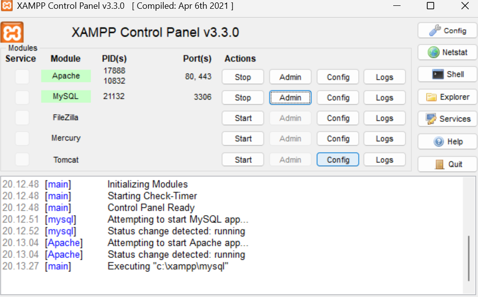

## 2. Mengakses phpMyAdmin

Buka `http://localhost/phpmyadmin/` di browser untuk mengelola database MySQL.

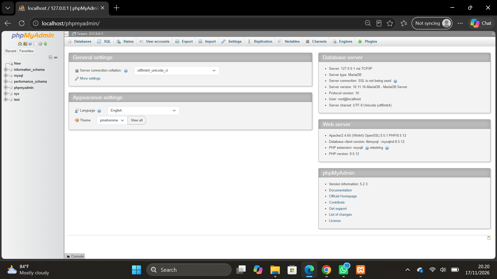

## 3. Membuat Database dan Tabel

Pada tab **SQL** di phpMyAdmin dijalankan query berikut untuk membuat database `latihan1` dan tabel `data_barang`.

```sql
CREATE DATABASE latihan1;

CREATE TABLE data_barang (
  id_barang int(10) auto_increment PRIMARY KEY,
  kategori varchar(30),
  nama varchar(50),
  gambar varchar(100),
  harga_beli decimal(10,0),
  harga_jual decimal(10,0),
  stok int(4)
);
```

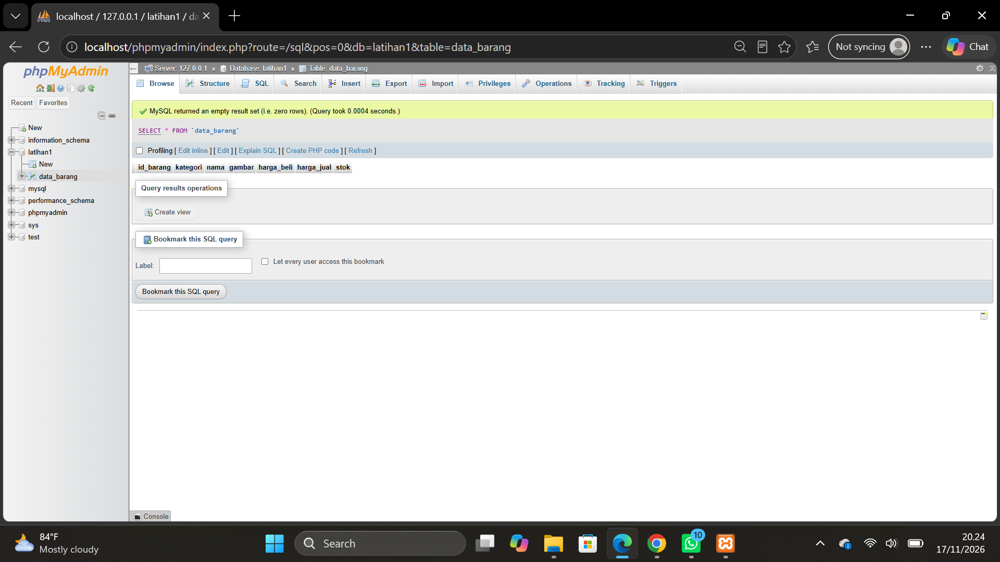

## 4. Menambahkan Data Awal

Data awal dimasukkan dengan perintah `INSERT INTO`.

```sql
INSERT INTO data_barang (kategori, nama, gambar, harga_beli, harga_jual, stok)
VALUES
('Elektronik', 'HP Samsung Android', 'hp_samsung.jpg', 2000000, 2400000, 5),
('Elektronik', 'HP Xiaomi Android', 'hp_xiaomi.jpg', 1000000, 1400000, 5),
('Elektronik', 'HP OPPO Android', 'hp_oppo.jpg', 1800000, 2300000, 5);
```

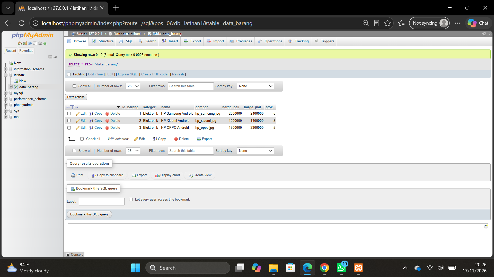

## 5. Membuat Folder Project

Folder `lab8_php_database` dibuat di dalam `htdocs` XAMPP (`C:\xampp\htdocs\lab8_php_database`), lalu diakses melalui `http://localhost/lab8_php_database/`. Di dalamnya dibuat juga folder `gambar` untuk menyimpan gambar yang diupload.


## 6. File Koneksi Database (`koneksi.php`)

File ini menghubungkan PHP ke MySQL menggunakan `mysqli_connect()` dengan host `localhost`, user `root`, password kosong, dan database `latihan1`. Jika koneksi gagal, program menampilkan pesan error lalu berhenti dengan `die()`.

```php
<?php
$host = "localhost";
$user = "root";
$pass = "";
$db   = "latihan1";

$conn = mysqli_connect($host, $user, $pass, $db);
if ($conn == false)
{
    echo "Koneksi ke server gagal.";
    die();
} #else echo "Koneksi berhasil";
?>
```

Pengujian koneksi (pesan "Koneksi berhasil" ditampilkan sementara dengan menghapus tanda komentar `#`):

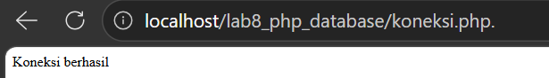

## 7. Menampilkan Data – Read (`index.php`)

`index.php` menjalankan query `SELECT * FROM data_barang`, lalu hasilnya diulang dengan `while` dan `mysqli_fetch_array()` dan ditampilkan dalam tabel. Setiap baris memiliki link **Ubah** dan **Hapus**, dan terdapat link **Tambah Barang** di atas tabel. Jika tabel kosong, ditampilkan pesan "Belum ada data". Fungsi `htmlspecialchars()` dipakai agar output aman dari XSS.

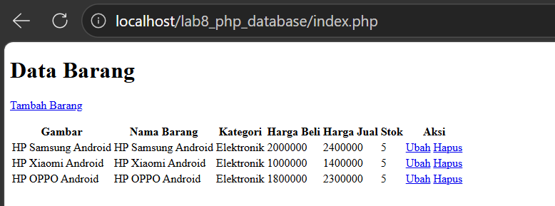

## 8. Menambah Data – Create (`tambah.php`)

Form menggunakan `method="post"` dan `enctype="multipart/form-data"` agar file gambar dapat dikirim. Setelah tombol **Simpan** ditekan:

1. Data form diambil dari `$_POST` dan file dari `$_FILES`.
2. Fungsi `upload_gambar()` (di `upload.php`) memindahkan gambar ke folder `gambar/` dengan `move_uploaded_file()` dan hanya menerima ekstensi gambar.
3. Data disimpan dengan `INSERT INTO` menggunakan prepared statement (`mysqli_prepare` dan `mysqli_stmt_bind_param`).
4. Pengguna diarahkan kembali ke `index.php` dengan `header('location: index.php')`.

Form tambah barang:

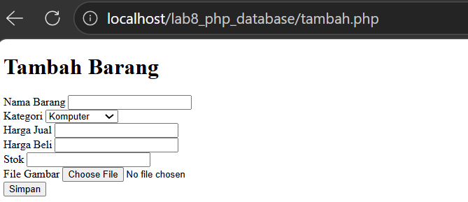

Hasil setelah data ditambahkan:

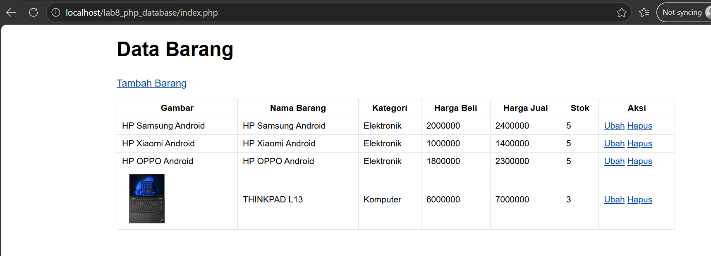

## 9. Mengubah Data – Update (`ubah.php`)

Barang yang akan diubah dipilih melalui link **Ubah** yang mengirim `id` lewat URL (`ubah.php?id=...`).

1. Data lama diambil dengan `SELECT ... WHERE id_barang = ?` dan ditampilkan pada form (atribut `value`).
2. Fungsi `is_select()` menandai kategori yang sesuai dengan data lama.
3. Input `hidden` menyimpan `id` agar ikut terkirim saat form disubmit.
4. Saat disubmit, dijalankan `UPDATE data_barang SET ... WHERE id_barang = ?`. Kolom gambar hanya diperbarui jika ada file baru yang diupload.

Form ubah barang:

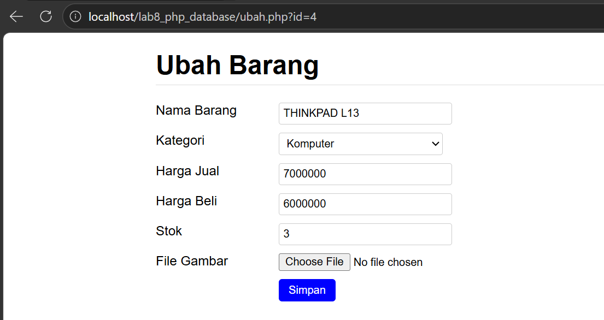

Hasil setelah data diubah:

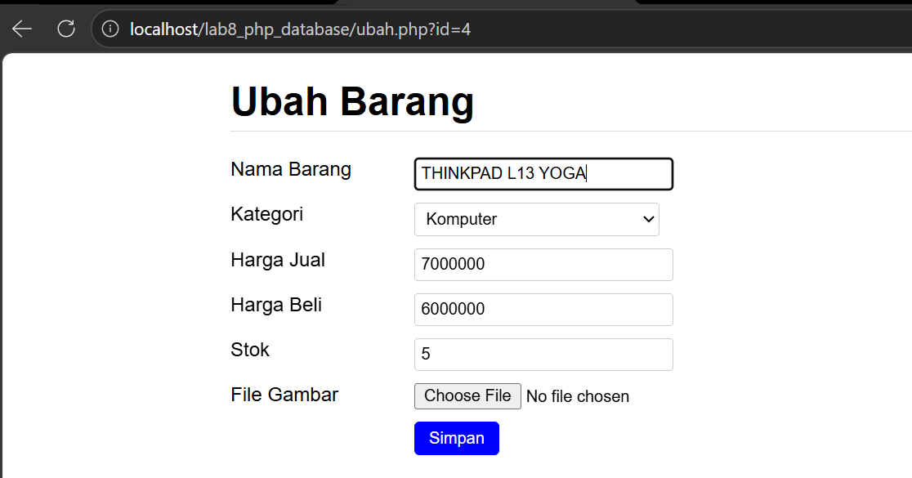

## 10. Menghapus Data – Delete (`hapus.php`)

Link **Hapus** mengirim `id` lewat URL (`hapus.php?id=...`). File `hapus.php` menjalankan `DELETE FROM data_barang WHERE id_barang = ?`, lalu mengarahkan kembali ke `index.php`. Di `index.php` terdapat konfirmasi JavaScript (`confirm()`) agar data tidak terhapus karena salah klik.

Dialog konfirmasi sebelum menghapus:

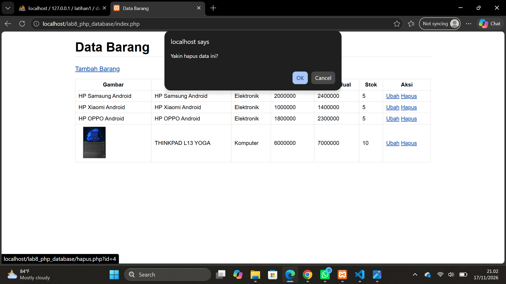

Hasil setelah data dihapus:

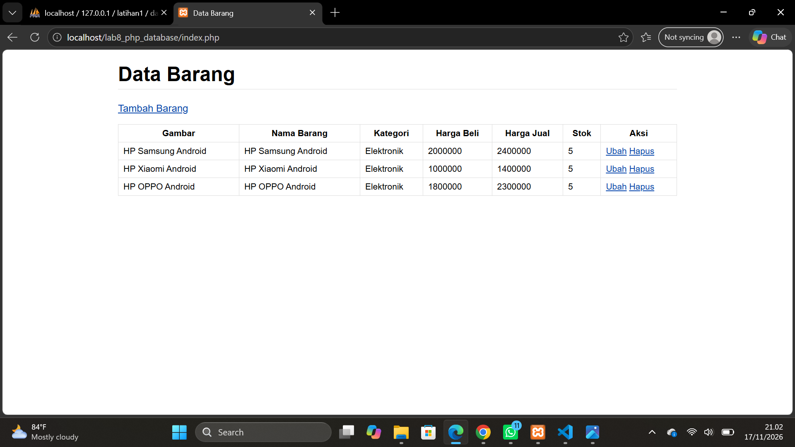

---

## Kesimpulan

Melalui praktikum ini dipahami cara menghubungkan PHP dengan database MySQL dan membuat aplikasi CRUD sederhana (Create, Read, Update, Delete) untuk data barang, termasuk upload gambar dan pengamanan query menggunakan prepared statement.
